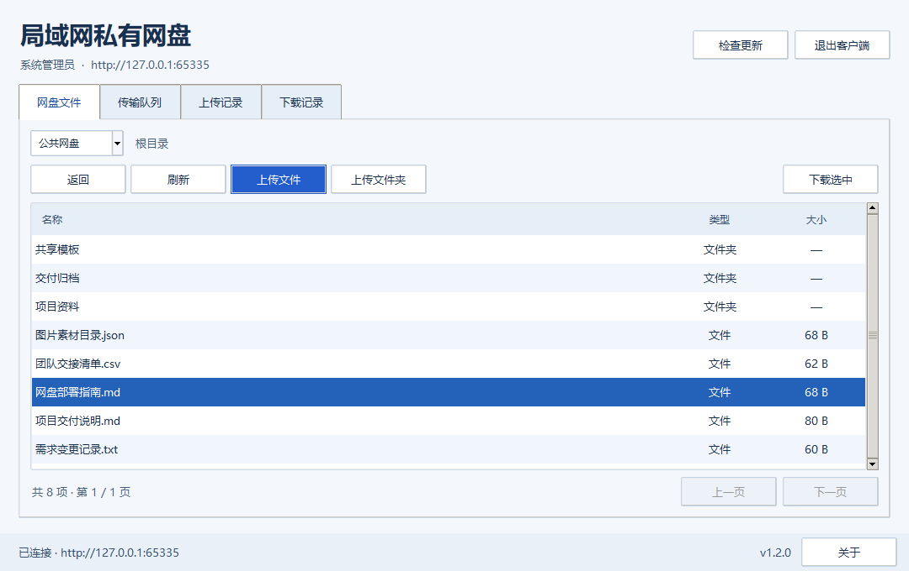
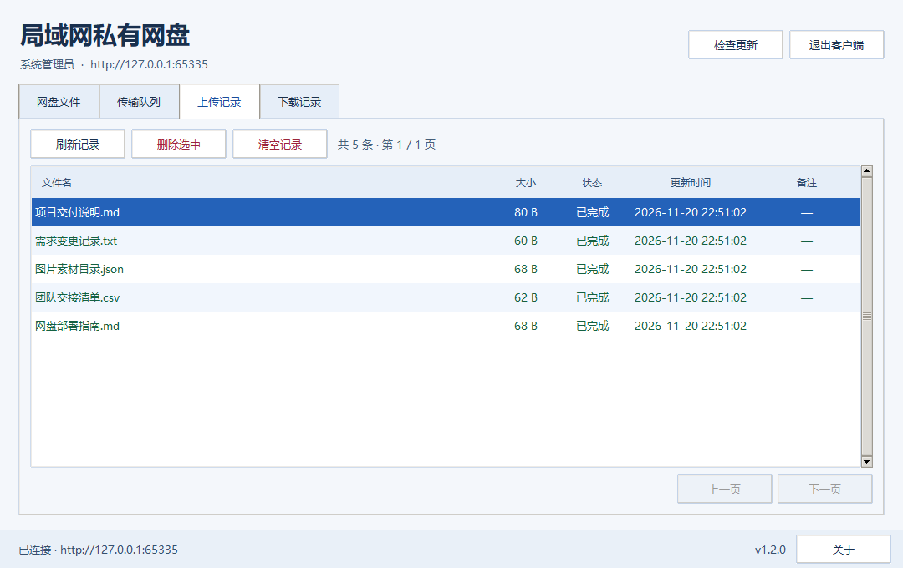
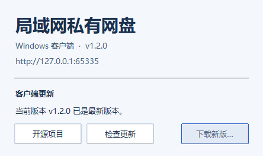

# 局域网私有网盘

服务提供桌面 Web、移动端 H5 和 Windows x64 客户端。前端资源、用户数据库、文件和日志由同一台局域网节点提供。首次安装依赖需要访问 npm 仓库，安装完成后网盘可在离线内网运行。

Windows 便携程序和服务端更新清单可在 [GitHub Releases](https://github.com/limingnanyue/lan-private-drive/releases/latest) 下载。

## 界面演示

以下截图来自 Windows 客户端 v1.2.0，网盘中的文件和记录为演示数据。

<details open>
<summary>公共网盘</summary>



</details>

<details>
<summary>上传记录</summary>



</details>

<details>
<summary>关于与客户端更新</summary>



</details>

## 启动与登录

1. 服务端安装 Node.js 22.11 或更高的 LTS 版本。在 Windows 双击 `start-drive.cmd`，也可在工作区执行下方命令。
2. 在服务端打开 `http://127.0.0.1:8080/`。同网段的其他设备打开启动输出中的 IPv4 地址和端口。
3. 新数据目录首次启动时，默认管理员账号和密码均为 `admin`。登录后在个人设置中修改密码。升级服务时继续使用原有账号和密码。
4. 在管理员后台配置挂载目录、配额和速度限制，再创建普通账号。更改挂载目录会迁移系统管理的文件对象和未完成的分片。

```powershell
npm.cmd ci
npm.cmd start
```

默认端口为 `8080`，默认数据目录为 `data`。SQLite 和存储目录均需位于服务端可读写位置。备份时先正常停止服务，再复制数据目录和另行配置的存储挂载目录。

「个人设置 → 个人信息」显示可复制的网盘地址和实际监听端口。超级管理员可在「管理员后台 → 系统设置 → 存储配置」选择服务器的 Windows 磁盘，也可以输入服务端目录。页面显示目标磁盘的总容量和剩余空间，以及当前挂载可用于上传的空间。网盘容量上限包含个人文件、公共文件、回收站和未完成上传的预留空间，填 `0` 表示由磁盘剩余空间决定。

| 环境变量 | 用途 |
| --- | --- |
| `LAN_DRIVE_PORT` | HTTP 或 HTTPS 端口 |
| `LAN_DRIVE_BIND` | 监听地址，默认 `0.0.0.0` |
| `LAN_DRIVE_DATA` | SQLite 和运行锁所在目录 |
| `LAN_DRIVE_ADMIN_PASSWORD` | 可选，首次启动时覆盖默认管理员密码，长度为 8 至 256 个字符 |
| `LAN_DRIVE_CERT`、`LAN_DRIVE_KEY` | 启用 HTTPS 的 PEM 证书和私钥路径 |
| `LAN_DRIVE_HOSTNAMES` | 逗号分隔的内网 DNS 别名 |
| `LAN_DRIVE_SHARE_ORIGIN` | 多网卡或 HTTPS 环境下生成分享链接使用的地址，例如 `https://drive.lan:8080` |

服务直接检查连接对端是否与接入网卡处于同一局域网网段。使用 HTTPS 时，为访问设备配置受信任的证书，并让证书覆盖访问地址。

## 传输、分享和离线文件

- 所有登录用户可浏览「公共网盘」。管理员在公共网盘页点击「下载权限」，可选择「所有登录用户」（默认）或按账号、昵称勾选「指定用户」。同一权限适用于预览、下载、续传、复制到个人网盘和保存离线副本。保存后立即生效，撤销授权会中断相关下载。
- 管理员在公共网盘页点击「上传权限」，可独立选择「仅管理员」（默认）、「指定用户」或「所有登录用户」。获授权的普通用户可新建文件夹并上传文件、文件夹。同名上传可重命名或跳过，已有内容由管理员整理。撤销授权会阻止后续分片写入和合并，重新授权后可以从已有断点续传。
- 普通管理员和超级管理员始终可下载、上传和整理公共文件，也可以从「我的文件」的复制或移动对话框选择「公共网盘」。公共文件删除后可在「回收站 → 公共回收站」还原。公共空间使用服务端磁盘，超级管理员可在存储占用分布查看用量。
- 在 Web 文件页面选择上传、拖拽文件或目录后，可切换到其他功能，当前标签页继续处理任务。标签页关闭或被系统休眠时，传输会中断。重新进入队列可继续下载，恢复上传时重新选择原文件。
- Windows 客户端可从 GitHub Releases 下载，也可登录已部署客户端更新包的网盘，在 Web 的「个人设置 → 个人信息」下载。运行便携程序后输入网盘首页地址和账号，再通过文件页的位置下拉菜单切换到「公共网盘」。关闭窗口会最小化并继续上传下载，使用「退出客户端」可结束程序。续传记录保存在当前 Windows 用户的本地应用数据目录。
- Windows 客户端和 Web 传输队列提供「上传记录」和「下载记录」，按页查看当前账号已完成、已取消和失败的任务。已完成和已取消的任务由服务定期清理，保留约 30 天。Windows 客户端可从本机的下载记录打开保存目录。
- 两个记录页均支持「删除选中」和「清空记录」。清理作用于当前账号和当前标签页，保留文件和续传断点。
- Windows 客户端底部的「关于」显示版本、服务地址和开源项目入口。登录后点「检查更新」可从当前连接的网盘服务器下载新版，查看进度并校验文件大小和 SHA-256。遇到短暂网络故障会自动重试。下载成功且文件传输已完成或暂停时，点击「运行新版」即可启动新版并退出旧程序。
- 超级管理员可在「管理员后台 → 系统日志」删除勾选项、清理筛选结果或清理全部日志。清理后系统记录删除数量，当日传输统计继续显示。
- 给账号共享时，在文件或文件夹菜单中配置成员权限。允许访客上传前先将目录设为共享文件夹。分享密码校验通过后，访客可在当前页面使用分享链接。
- 按文件选择「保存离线副本」，在「离线文件」查看或下载。重新打开离线页面需要 HTTPS 或本机回环地址，普通局域网 HTTP 可在已经打开的标签页中查看已保存的副本。
- 「记住我」延长登录凭据的最长有效期至 7 天，仍按系统设置执行无操作超时。普通管理员管理自己创建的普通账号，并管理这些账号的共享文件夹。超级管理员具备查看其他账号文件的权限。

## 接口与验收

API 基础路径为 `/api/v1`，JSON 响应包含 `code`、`msg` 和 `data`。外部客户端从 `/auth/login` 获取 Bearer token，传输进度通过 `/ws/task` 推送。服务返回右下角任务列表所需的任务状态和字节数。

- 使用 `GET /fs/list?space=public` 获取公共根目录，返回当前账号的 `canDownload` 和 `downloadMode`。返回的 `folder.id` 可作为目录编号。管理员通过 `GET /fs/public/download-policy` 获取策略和可选用户，通过 `PUT /fs/public/download-policy` 提交 `{ mode, userIds }`。模式为 `all` 或 `selected`，指定用户模式提交普通用户编号。
- 公共目录列表同时返回 `canUpload` 和 `uploadMode`。管理员可通过 `GET /fs/public/upload-policy` 和 `PUT /fs/public/upload-policy` 管理上传范围。模式为 `admin`、`selected` 或 `all`，提交格式与下载权限相同。
- 管理员使用 `/recycle/list?space=public` 查看公共回收站，还原和永久删除时使用同一个查询参数。
- 上传可先调用 `/task/upload/start`，再向 `/fs/upload` 提交 `taskId`、字节 `offset` 和 `file` 分片，最后调用 `/fs/upload/merge`。也支持分片序号协议，第一个分片传入 `chunkIndex=0`、`totalChunk`、`file`，多分片补充 `totalSize`，后续请求携带返回的 `fileKey`。
- 单文件下载和预览支持 HTTP `Range`。队列下载由 `/task/download/start` 建立任务，客户端分段读 `/task/download/data`，每段落盘后用 `/task/progress` 更新断点。
- `GET /task/list?active=1` 返回可继续处理的任务。`GET /task/history?type=upload` 或 `type=download` 按 `page`、`size` 分页查询记录。使用 `GET /task/info?taskId=...` 读取当前账号的单个任务。
- `DELETE /task/history?type=upload` 或 `type=download` 接收 `{ taskIds }` 或 `{ clear: true }`，返回已清理的 `deleted` 数量。
- 日志列表、CSV 导出和 `DELETE /admin/log/clear` 使用相同的筛选参数。`DELETE /admin/log/delete` 接收 `{ logIds }`，两个删除接口均返回 `deleted`。
- `npm.cmd test` 验证账号隔离、权限、重启续传、重名冲突、分享、回收站、支持范围下载和 ZIP、日志、配置迁移、限速及分片协议。
- `python -m unittest discover -s tests -p test_client.py -v` 验证 Windows 客户端断点续传、公共网盘权限、记录清理和更新流程。

## 发布桌面客户端

为网盘部署现成的更新包时，从同一个 GitHub Release 下载 `LanDrive-<版本>-<校验值>.exe` 和 `windows.json`。保持文件名，将两者放入服务端项目的 `release/` 目录，先放入程序，再更新清单。

从源码构建需使用 Windows 和 Python 3.12 x64。发布新版本前修改 `client/drive.py` 中的 `CLIENT_VERSION`，再运行以下命令。构建脚本通过程序自检后生成便携程序和更新清单，并在 `release/LanDrive.exe` 提供固定文件名的副本。

```powershell
python -m pip install pyinstaller
python client/build_release.py
```

## 开源许可

项目源码采用 [MIT 许可证](LICENSE)。
